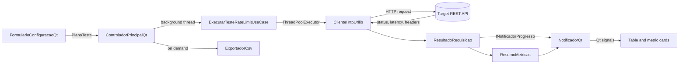

<div align="center">

# Rate Limit Validator 🛡️

**Desktop application for validating rate-limit policies, exercising concurrent traffic, and measuring REST API resilience under load.**

[](https://github.com/felipevenas/rate-limit-validator/actions/workflows/ci.yml)
[](https://www.python.org/)
[](https://doc.qt.io/qtforpython/)
[](https://github.com/felipevenas/rate-limit-validator/releases)
[](LICENSE)
[](https://github.com/felipevenas/rate-limit-validator/releases)

<br />

<p align="center">
  <a href="#overview"><b>Overview</b></a> •
  <a href="#stack"><b>Stack</b></a> •
  <a href="#architecture"><b>Architecture</b></a> •
  <a href="#quick-start"><b>Quick Start</b></a> •
  <a href="#usage"><b>Usage</b></a> •
  <a href="#configuration"><b>Configuration</b></a> •
  <a href="#features"><b>Features</b></a> •
  <a href="#testing"><b>Testing</b></a> •
  <a href="#packaging-and-release"><b>Packaging</b></a> •
  <a href="#known-limitations-mvp-trade-offs"><b>Limitations</b></a> •
  <a href="#governance"><b>Governance</b></a>
</p>

</div>

---

> **Repository:** [felipevenas/rate-limit-validator](https://github.com/felipevenas/rate-limit-validator) ·
> **Releases:** [download the Windows executable](https://github.com/felipevenas/rate-limit-validator/releases) ·
> **Runtime:** local desktop application, no backend service required

## Overview

Rate Limit Validator is a local Windows desktop application for engineers who need evidence that an API actually enforces its throttling policy. It sends a configurable burst of HTTP requests through a thread pool, records every response, and presents status codes, latency, `Retry-After`, and `X-RateLimit-*` headers in real time.

It is built for backend engineers, QA engineers, SREs, and security reviewers validating APIs they own or are explicitly authorized to test. The application runs entirely on the operator's machine: there is no hosted backend, no telemetry, and no data leaves the process except the HTTP requests sent to the target endpoint and the CSV report the operator chooses to save.

### What this application owns

| Area | Responsibility |
|---|---|
| Request configuration | URL, HTTP method, headers, JSON body, timeout, and per-request delay |
| Concurrent execution | Thread-pool scheduling of a fixed request budget with graceful cancellation |
| Response capture | Status code, latency, `Retry-After`, `X-RateLimit-*` / `RateLimit-*` headers, and transport errors |
| Live observability | Progress, 2xx/429/error counts, average latency, and effective requests per second |
| Reporting | Semicolon-delimited CSV with a statistical summary and one row per request |
| Desktop experience | PySide6 interface, dark/light themes, system tray, native notifications, and contextual help |

> **Scope note:** this is a single-process concurrency and policy-validation tool, not a distributed load generator. See [Known Limitations](#known-limitations-mvp-trade-offs) for the exact boundaries.

## Stack

| Layer | Technology | Version / notes |
|---|---|---|
| Language | Python | 3.10, 3.11, and 3.12 validated in CI |
| Desktop UI | PySide6 (Qt for Python) | `PySide6>=6.6.0` from [`requirements.txt`](requirements.txt) |
| HTTP transport | Python standard library | `urllib.request`, `urllib.error`, `ssl` |
| Concurrency | Python standard library | `concurrent.futures.ThreadPoolExecutor`, `threading.Event` |
| Domain modeling | Python standard library | `dataclasses`, `abc` |
| Reporting | Python standard library | `csv` with UTF-8 BOM (`utf-8-sig`) |
| Testing | `unittest` | 17 tests in the current suite |
| Test tooling | pytest / pytest-cov | `pytest>=8.0.0`, `pytest-cov>=4.1.0` (optional locally; CI uses `unittest`) |
| Packaging | PyInstaller | `pyinstaller>=6.5.0` from [`requirements-dev.txt`](requirements-dev.txt) |
| Automation | GitHub Actions | Cross-platform tests and tagged Windows releases |
| License | MIT | See [`LICENSE`](LICENSE) |

There is no runtime dependency beyond PySide6: the HTTP client, thread orchestration, metrics, and CSV writer use the standard library.

## Architecture

The code follows **Clean Architecture** and **SOLID** boundaries. Dependencies point inward: presentation depends on application and domain; application depends on domain contracts; infrastructure implements those contracts. `main.py` is the composition root and the only place where concrete implementations are wired together.

```text
rate-limit-validator/
├── main.py                                  # Composition root and Qt entry point
├── src/
│   ├── domain/                              # Pure business rules, no Qt or network imports
│   │   ├── entities/
│   │   │   ├── configuracao_requisicao.py   # Validated HTTP request configuration
│   │   │   ├── plano_teste.py               # Total requests, concurrency, delay
│   │   │   ├── resultado_requisicao.py      # Per-request result and 429/header parsing
│   │   │   └── resumo_metricas.py           # Aggregated counters, latency, RPS
│   │   └── interfaces/
│   │       ├── cliente_http.py              # IClienteHttp contract
│   │       └── notificador_progresso.py     # INotificadorProgresso contract
│   ├── application/
│   │   └── use_cases/
│   │       └── executar_teste_rate_limit.py # ThreadPoolExecutor orchestration and cancellation
│   ├── infrastructure/
│   │   ├── http/
│   │   │   └── cliente_http_urllib.py       # urllib/SSL client with latency measurement
│   │   └── exporters/
│   │       └── exportador_csv.py            # CSV summary and detail rows
│   └── presentation/
│       ├── assets/icons/                    # SVG, PNG, and ICO application icons
│       ├── styles/tema.py                   # Central QSS design system (dark/light)
│       ├── controllers/
│       │   ├── controlador_qt.py            # Qt controller, signals, background thread
│       │   └── controlador_principal.py     # Legacy Tkinter controller (not used by main.py)
│       └── views/
│           ├── janela_principal_qt.py       # QMainWindow, theme switch, system tray
│           ├── componentes/                 # Qt form, metrics panel, table, help button
│           ├── janela_principal.py          # Legacy Tkinter window (not used by main.py)
│           └── componentes/ajuda_tooltip.py # Legacy Tkinter tooltip helpers
├── scripts/
│   ├── build_executavel.py                  # PyInstaller --onefile build
│   └── gerar_icone_ico.py                   # SVG → PNG/ICO icon generation
├── tests/                                   # unittest suites
├── .agents/                                 # Specialized agent role definitions
├── .github/                                 # CI, release, labels, issue/PR templates
├── .env.example                             # Reference environment values (not loaded at runtime)
├── requirements.txt                         # Runtime dependency
└── requirements-dev.txt                     # Tests and packaging dependencies
```

### Layer responsibilities

| Layer | Owns | Must not |
|---|---|---|
| `domain` | Entities, invariants, and abstract contracts | Import Qt, `urllib`, or presentation code |
| `application` | Use-case orchestration, concurrency, cancellation | Render UI or open sockets directly |
| `infrastructure` | HTTP transport, SSL context, CSV persistence | Contain UI or business rules |
| `presentation` | Qt widgets, controller signals, styling, help content | Bypass use cases or duplicate domain validation |

### Execution flow



1. The form validates input and builds an immutable `ConfiguracaoRequisicao` inside a `PlanoTeste`.
2. `ControladorPrincipalQt` starts the use case on a daemon thread so the Qt event loop stays responsive.
3. The use case submits one task per request to a `ThreadPoolExecutor` bounded by the configured concurrency.
4. `ClienteHttpUrllib` performs each request with the configured timeout and converts both HTTP responses and transport failures into `ResultadoRequisicao` values.
5. Each completed request updates `ResumoMetricas` and is emitted to the UI through Qt signals; the table inserts rows as responses arrive.
6. Cancellation sets a `threading.Event`; pending tasks stop before sending and the suite finishes with a cancelled status.

## Quick Start

### Prerequisites

- **Python 3.10–3.12** (validated by CI). Python 3.11 is used by the release workflow.
- **Git**.
- **Windows x64** for the packaged executable; source execution also works on Linux and macOS.
- No database, API key, or external service is required to start the application.

### Run from source

```powershell
git clone https://github.com/felipevenas/rate-limit-validator.git
cd rate-limit-validator
python -m venv .venv
.\.venv\Scripts\Activate.ps1
python -m pip install --upgrade pip
pip install -r requirements-dev.txt
python main.py
```

On Linux or macOS, create and activate the environment with:

```bash
python3 -m venv .venv
source .venv/bin/activate
python -m pip install --upgrade pip
pip install -r requirements-dev.txt
python main.py
```

The main window opens with `https://httpbin.org/get` pre-filled. Replace it with an endpoint you own or are authorized to test before starting a run.

### Run the packaged release

1. Open [Releases](https://github.com/felipevenas/rate-limit-validator/releases).
2. Download `ValidadorRateLimit.exe` from the latest release.
3. Run the file directly. It is a portable, single-file build: no installer and no Python installation are required.

> The executable is not code-signed. Windows SmartScreen may warn on first launch; verify the download against the release checksum or build it yourself from source if this matters for your environment.

### Verify the installation

```powershell
python -m unittest discover tests
```

The suite should report `OK` with 17 tests.

## Usage

1. **Choose the target.** Enter the full `http(s)://` URL and select the HTTP method (`GET`, `POST`, `PUT`, `DELETE`, `PATCH`, `HEAD`, or `OPTIONS`).
2. **Set the load shape.** Define total requests, concurrency, delay, and timeout. Concurrency is automatically clamped to the total request count, so the tool never opens more workers than requests.
3. **Add request data when needed.** Use the **Headers** tab for `Key: Value` lines or a JSON object. Use the **Body** tab for a JSON payload; the body is sent only for `POST`, `PUT`, `PATCH`, and `DELETE`.
4. **Start the run.** Click **Iniciar Teste**. Rows appear as responses arrive, and the metric cards update live.
5. **Read the result.** A `429` is highlighted as a rate-limit block. `Retry-After` and `X-RateLimit-*` / `RateLimit-*` values are captured when the API returns them.
6. **Export or clear.** Use **Exportar Relatório (CSV)** to save the current run, or **Limpar** to reset the table before the next run.

### Runtime parameters

| Parameter | UI range | Default | Behavior |
|---|---:|---:|---|
| Total requests | 1–100,000 | 50 | Fixed request budget for the run |
| Concurrency (threads) | 1–200 | 5 | Maximum simultaneous workers; clamped to total requests |
| Delay | 0–10,000 ms | 0 | Pause applied before each request task is sent |
| Timeout | 1–120 s | 10 | Per-request socket timeout |
| HTTP method | 7 methods | `GET` | Drives whether a body is transmitted |
| Retry-After | read-only | — | Captured from `Retry-After` or `X-RateLimit-Reset-After` / `RateLimit-Reset` |
| Rate-limit headers | read-only | — | Captured from `X-RateLimit-*` and `RateLimit-*` variants |

### Reading the results

- **Success (2xx):** accepted responses.
- **Rate Limit (429):** requests rejected with HTTP `429 Too Many Requests`.
- **Errors / failures:** transport errors, timeouts, and every non-2xx status that is not 429.
- **Average latency:** arithmetic mean of all recorded request latencies in milliseconds.
- **RPS:** total processed requests divided by the wall-clock duration of the run.

The detailed table supports free-text search, category filters, header-click sorting, auto-scroll, and per-row status highlighting. The `?` buttons provide parameter-level explanations inside the application.

### Desktop behavior

- Toggle **Dark Mode** and **Light Mode** from the status bar or the system tray menu.
- The tray menu restores the window, switches the theme, or exits.
- A tray notification reports completion, cancellation, or a fatal error.
- Closing the window during a run asks for confirmation before cancelling the suite.

## Configuration

All test parameters are configured in the application window. There is no configuration file required to run the tool.

### `.env.example`

The repository ships [`.env.example`](.env.example) as a reference for deployment or future automation. **The current application does not read environment variables or load a `.env` file**; these values are documentation only and have no runtime effect.

| Variable | Example value | Description |
|---|---|---|
| `DEFAULT_TARGET_URL` | `https://httpbin.org/get` | Suggested default endpoint for a run |
| `LOG_LEVEL` | `INFO` | Suggested logging level (`DEBUG`, `INFO`, `WARNING`, `ERROR`) |
| `DEFAULT_TIMEOUT_SECONDS` | `10` | Suggested default request timeout in seconds |
| `VERIFY_SSL` | `true` | Suggested SSL certificate verification flag |

Never commit real credentials, bearer tokens, API keys, or private endpoints. The application stores headers and bodies only in memory for the duration of the run.

### SSL and transport

- Certificate verification is enabled in the composition root (`ignorar_verificacao_ssl=False`).
- The HTTP client sets a default `User-Agent` of `ValidadorRateLimit/1.0 (Python Desktop)` when none is supplied.
- Redirects follow `urllib`'s standard behavior; the final response is what the table records.

## Features

- **Thread-pool concurrency** with a fixed request budget, bounded workers, optional per-request delay, and cooperative cancellation.
- **Seven HTTP methods** with custom headers, JSON body support, and request-level timeout control.
- **Live table** with one row per response, status highlighting, free-text search, category filters, column sorting, and auto-scroll.
- **Live metrics**: progress bar, 2xx/429/error counters, average latency, and effective requests per second.
- **Rate-limit evidence**: `Retry-After` and common `X-RateLimit-*` / `RateLimit-*` headers are captured and exposed in the result model and CSV detail row.
- **CSV report generation**: summary statistics plus one detail row per request, written as UTF-8 with BOM and `;` delimiters for spreadsheet compatibility.
- **Premium desktop shell**: custom QSS design system, dark/light themes, vector icon assets, native system tray, and Windows AppUserModelID registration.
- **Contextual help**: rich HTML tooltips and explanatory dialogs for every technical parameter.
- **Cross-platform CI** and a reproducible PyInstaller build for tagged Windows releases.

> The CSV exporter is implemented and unit-tested. The current UI controller passes arguments to it with an outdated signature, so the export action currently fails at runtime. See [Known Limitations](#known-limitations-mvp-trade-offs).

## Testing

The suite uses the standard library `unittest` runner and does not require a live API.

```powershell
python -m unittest discover tests
```

| Suite | File | Covers |
|---|---|---|
| Domain | [`tests/test_dominio.py`](tests/test_dominio.py) | URL/method validation, plan invariants, 429/header parsing, metric aggregation |
| Use case | [`tests/test_caso_de_uso.py`](tests/test_caso_de_uso.py) | Full execution with a mocked client and immediate cancellation |
| CSV exporter | [`tests/test_exportador_csv.py`](tests/test_exportador_csv.py) | File creation, summary labels, and detail content |
| Qt interface | [`tests/test_interface_qt.py`](tests/test_interface_qt.py) | Help button, form defaults, metric cards, table filters, window/controller wiring |
| Legacy Tk help | [`tests/test_ajuda_tooltip.py`](tests/test_ajuda_tooltip.py) | Tooltip lifecycle and help-label composition |

The current suite contains **17 tests** and passes locally on Python 3.11.9 with PySide6 6.11.2.

### CI gate

[`ci.yml`](.github/workflows/ci.yml) runs `python -m unittest discover tests` on:

- `ubuntu-latest` and `windows-latest`;
- Python `3.10`, `3.11`, and `3.12`.

The workflow installs only [`requirements.txt`](requirements.txt), so the gate depends on PySide6 and the standard library. Linux jobs install the Qt/Tk GUI libraries and run the suite under Xvfb with `QT_QPA_PLATFORM=offscreen`; Windows jobs run the same suite natively. No linter, type checker, or coverage threshold is configured in CI.

## Packaging and Release

The build is documented as a script rather than a committed PyInstaller spec. The `*.spec` file is generated by PyInstaller during the build and is ignored by Git.

```powershell
python scripts/gerar_icone_ico.py
python scripts/build_executavel.py
```

`build_executavel.py` runs PyInstaller with:

- `--noconsole` (windowed application);
- `--onefile` (single portable executable);
- `--clean`;
- `--name ValidadorRateLimit`;
- the generated `app_icon.ico`;
- the `src/presentation/assets` directory bundled through `--add-data`.

Output: `dist/ValidadorRateLimit.exe`.

### Release workflow

[`build_release.yml`](.github/workflows/build_release.yml) runs on `v*` tags and on manual dispatch:

1. Checkout on `windows-latest`.
2. Install Python 3.11, runtime requirements, and PyInstaller.
3. Regenerate the icon assets.
4. Build the executable.
5. Upload the `ValidadorRateLimit-Windows` artifact.
6. On a tag push, create a GitHub Release with generated notes and attach the `.exe`.

```powershell
git tag v2.0.1
git push origin v2.0.1
```

Pushing a tag publishes a release; do not create a tag until the build and changelog are ready.

## Known Limitations (MVP Trade-offs)

These are deliberate boundaries of the current version, not hidden behavior.

### Load generation

- Concurrency is **single-process and thread-based**, with a UI maximum of 200 workers. It is not a distributed load test and cannot saturate infrastructure the way a purpose-built load generator can.
- Python's GIL and the blocking `urllib` client bound throughput on the client machine. Results describe the observed client-side behavior, not the target's absolute capacity.
- There is no ramp-up, staged traffic profile, duration-based run, or request scheduling. The run is a fixed budget of requests with an optional fixed delay.
- Metrics use simple counters and an arithmetic mean; there are no percentiles, histograms, or time-series retention.
- No state is persisted between runs. Closing the application discards the current results unless a CSV was saved.

### Protocol and policy coverage

- Rate limiting is detected **only through HTTP 429**. APIs that signal throttling with `403` or `503` are classified as generic errors even though some legacy services use those codes.
- `Retry-After` and rate-limit headers are recorded and displayed, but the application does **not** retry, back off, or pace traffic automatically based on them.
- The client does not implement cookie jars, OAuth flows, client certificates, proxy configuration, HTTP/2, WebSocket, or gRPC. Authentication must be supplied manually as headers.
- Request bodies are sent only for `POST`, `PUT`, `PATCH`, and `DELETE`; `GET`, `HEAD`, and `OPTIONS` bodies are ignored.
- TLS verification is enabled and not configurable from the UI. The infrastructure client accepts an `ignorar_verificacao_ssl` flag, but the composition root always passes `False`.

### Runtime configuration and reporting

- `.env.example` is not loaded by the application; runtime values come from the UI only.
- The CSV **exporter** works and is tested, but the current Qt controller calls it with a mismatched signature. Until that wiring is corrected, the UI export action raises a parameter error instead of writing a file.
- The application has no environment-variable, CLI, or profile-based configuration.
- Saved CSV content is localized in Portuguese (summary labels and status text).

### Interface and platform

- The UI strings and help content are **Brazilian Portuguese**; repository documentation and collaboration templates are English.
- Legacy Tkinter modules (`janela_principal.py`, `controlador_principal.py`, `ajuda_tooltip.py`, and the non-`_qt` components) remain in the tree but are not wired by `main.py`. They are kept for reference and for the existing Tk help test.
- The Windows executable is unsigned. SmartScreen or enterprise policy may block or warn on first launch.
- The application is Windows-first. Source execution is testable on Linux, but Linux/macOS packaging is not part of the release workflow.

### Continuous integration

- The workflow installs runtime dependencies only; development tools such as pytest and pytest-cov are not part of the CI environment.
- Linux jobs install the Qt/Tk GUI libraries and run the suite under Xvfb with `QT_QPA_PLATFORM=offscreen`; Windows jobs run the same suite natively.
- There is no lint, formatting, type-check, or coverage gate. Contributions are expected to pass the test suite and follow the architecture rules manually.

## Governance

This repository follows a formal governance model shared by the DevRats projects. **English is the default language for the README, contribution guide, security policy, changelog, and collaboration templates.** The application UI remains in Brazilian Portuguese.

| Document | Purpose |
|---|---|
| [`CONTRIBUTING.md`](CONTRIBUTING.md) | Local setup, branch/commit flow, architecture rules, and Definition of Done |
| [`CODE_OF_CONDUCT.md`](CODE_OF_CONDUCT.md) | Community standards and enforcement |
| [`SECURITY.md`](SECURITY.md) | Supported versions and private vulnerability disclosure |
| [`CHANGELOG.md`](CHANGELOG.md) | Release history ([Keep a Changelog](https://keepachangelog.com/en/1.1.0/) + SemVer) |
| [`LICENSE`](LICENSE) | MIT License |
| [`.github/`](.github) | Issue/PR templates, CI, release, and label automation |
| [`.agents/`](.agents) | Specialized role definitions used for multi-agent development |
| [`requirements.txt`](requirements.txt) · [`requirements-dev.txt`](requirements-dev.txt) | Runtime, test, and packaging dependencies |

### Repository standards

- **Workflow:** short-lived branches merged into `main` through pull requests.
- **Commits:** Conventional Commits in English (`feat:`, `fix:`, `refactor:`, `docs:`, `test:`, `chore:`).
- **Architecture:** `domain` stays framework-free; `application` orchestrates; `infrastructure` implements contracts; `presentation` renders and emits signals.
- **Quality gate:** `python -m unittest discover tests` must pass; new behavior requires tests.
- **Security:** no secrets in the repository, no unauthorized stress testing, and no credentials in logs, screenshots, or CSV reports.

## Related Documentation

- [`CONTRIBUTING.md`](CONTRIBUTING.md) — setup, conventions, and pull-request expectations.
- [`SECURITY.md`](SECURITY.md) — responsible disclosure and security scope.
- [`CHANGELOG.md`](CHANGELOG.md) — version history and release notes.
- [`.github/workflows/ci.yml`](.github/workflows/ci.yml) — cross-platform test matrix.
- [`.github/workflows/build_release.yml`](.github/workflows/build_release.yml) — Windows executable and release pipeline.
- [`scripts/build_executavel.py`](scripts/build_executavel.py) — local PyInstaller build.
- [Releases](https://github.com/felipevenas/rate-limit-validator/releases) — published Windows builds.
- [GitHub repository](https://github.com/felipevenas/rate-limit-validator) — source, issues, and discussions.

## License

Distributed under the **MIT License**. See [`LICENSE`](LICENSE) for the full text.

<div align="center">
Built with care by <b><a href="https://github.com/felipevenas">Felipe Venas</a></b>
</div>
